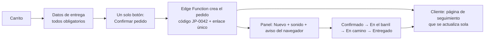

# JP Smoke · hamburguesas al barril — sitio, pedidos y panel

> **Fuente de verdad del proyecto.** Alcance, fases, decisiones (D1…Dn) y registro de cambios. Manda sobre todo lo demás.
>
> **Versión:** 0.13 · **Creado:** 2026-11-01 · **Fase actual:** F10 hecha en local · Siguiente: montaje cuando Gustavo apruebe (D25)

## Índice

1. Visión y principios · 2. Usuarios y roles · 3. Sitio público · 4. Pedidos · 5. Panel de administración · 6. Marca y diseño · 7. Seguridad · 8. Stack · 9. Modelo de datos · 10. Hosting · 11. Propuestas · 12. Fases · 13. Pruebas · 14. Decisiones · 15. Registro de cambios · 16. Pendientes de Gustavo · 17. Producto para varios restaurantes · 18. Referencias

---

## 1. Visión y principios

**JP Smoke** es una hamburguesería al barril en Bogotá. Por ahora **solo domicilio**; el punto físico llega después. La micro app tiene dos caras:

- **Sitio público** que lleva a **pedir** (lo más importante): carta, carrito y pedido por la web o por WhatsApp.
- **Panel privado** para el negocio: pedidos en vivo, ventas y estadísticas, editor de carta y sitio, promociones, cupones, eventos y banners.

Principios:

1. **Pedir en 3 toques** desde el celular. El botón de pedido siempre está a la mano.
2. **Cero pedidos falsos**: todo pedido pasa por el servidor con validación, límites y verificación del celular.
3. **Todo editable desde el panel**: precios, productos, fotos, textos, canales (Rappi, DiDi), promociones y eventos. Nada quemado en el código.
4. **Todo pedido queda registrado**: web o WhatsApp, entra al panel y cuenta en ventas.
5. **Seguridad por defecto**: el navegador del cliente nunca toca datos de otros clientes ni el panel.

## 2. Usuarios y roles

| Rol | Qué hace |
|---|---|
| Cliente (sin cuenta) | Ve la carta, arma su pedido, lo confirma con celular verificado y lo sigue con un código |
| `admin` | Todo: ventas, editor, promociones, ajustes, cuentas |
| `operador` | Solo **Resumen** (sin dinero) y **Pedidos** (recibir, cambiar estado, avisar al cliente, pedido manual). Sin ventas, estadísticas, editor, clientes ni ajustes (D19) |

Cuentas creadas solo por el admin; registro público apagado.

## 3. Sitio público

Referencia de estructura: [barrilburger.com](https://www.barrilburger.com/) (botones, acciones, flujo de catálogo → pedido). Referencia de estilo y movimiento: `docs/diseno/REFERENCIA-impossible.md`. **No se copia el diseño de Barril Burger.**

Orden de secciones (D5):

| # | Sección | Contenido | Notas |
|---|---|---|---|
| 0 | Bienvenida | El admin elige en el panel: **pantalla completa** (foto del evento), **aviso centrado** (ventana pequeña; puede captar nombre, celular y cumpleaños a cambio de un cupón) o **nada** | D11, D16 |
| 1 | Encabezado fijo | Logo, menú, carrito con contador, "Pedir" | Menú tipo cajón en celular |
| 2 | Inicio | Titular gigante, 4 productos que se despliegan al hacer scroll, "Pedir ahora" y "Pedir por WhatsApp" | Productos grandes (D7). Aviso "Solo domicilio · punto físico pronto" |
| 3 | Franja de eventos y novedades | Banners activos creados en el panel | Se oculta si no hay ninguno |
| 4 | Arsenal pesado | Destacados en carrusel: foto, etiqueta, nombre, descripción, precio sola/combo, agregar | El admin marca cuáles salen |
| 5 | Carta completa | Filtro por categoría (fijo al bajar), buscador, todos los productos | Sola / combo, adicionales |
| 6 | Promociones | Promo destacada ("el frío bogotano se corta con fuego") y cupones visibles | Antes estaba arriba; va abajo (D5) |
| 7 | JP on Tour | Eventos privados y catering con formulario de cotización | Antes estaba arriba; va abajo (D5) |
| 8 | Prueba social | Reseñas reales aprobadas en el panel | Sin reseñas inventadas en producción |
| 9 | Cobertura / ubicación | Zonas de domicilio; "Punto físico próximamente" | Dirección, horario y enlace a Google Maps cuando el admin abre el local (F10, D33) |
| 10 | Cierre y pie | CTA final, horarios, redes, legales, PQRS | |

**Fuera (D6):** el bloque "Cero plástico, cero corporativo, puro barril" no va.

**Rappi y DiDi (D8):** se construyen completos (encabezado, inicio, carrito) pero **ocultos**. Se muestran con un interruptor en el panel (Editor → Canales).

Botones flotantes: WhatsApp (escritorio) y barra inferior en celular (Carta · Mi pedido · WhatsApp).

## 4. Pedidos

### 4.1 Flujo web



Campos obligatorios: nombre, celular colombiano (10 dígitos, empieza por 3), dirección, barrio, localidad (zona de cobertura), medio de pago. **Los medios de pago se activan, quitan y agregan desde el panel** (D17). Opcionales: indicaciones, "¿con cuánto pagas?" si es efectivo. Autorización de datos (Ley 1581) sin marcar por defecto.

### 4.2 Pedidos por WhatsApp (D10)

**Un solo botón "Confirmar pedido"** (D15). Todo se maneja en la página, sin WhatsApp de por medio (D20):

| Quién | Cómo se entera | Costo |
|---|---|---|
| Parrillero / operador | El pedido entra al tablero con sonido y **aviso del navegador** aunque el panel esté en otra pestaña. Con el panel instalado en el celular (P9), notificación push | $0 |
| Cliente | Pantalla final con **"Seguir mi pedido"** y **enlace único** (`/pedido/JP-0042?t=…`) que se actualiza solo con cada cambio de estado | $0 |
| Más adelante (F9, opcional) | WhatsApp automático con el enlace de seguimiento | Por mensaje |

### 4.2 Seguimiento sin cuenta (D21)

- **Enlace único** por pedido: código + token aleatorio. El token se guarda con hash; la función `seguir-pedido` devuelve solo estado, horas, productos, total, barrio y la dirección enmascarada (nunca el celular).
- **Se recuerda en el navegador**: mientras el pedido esté activo (hasta 8 h), la página muestra un botón flotante "Tu pedido JP-0042 · En el barril →". Si recarga o vuelve otro día, ahí está.
- **"Seguir pedido"** en el menú y el pie: lista los pedidos hechos desde ese celular o permite buscar con **código + últimos 4 dígitos** del celular (límite de intentos).
- El operador puede copiar el enlace desde el pedido si el cliente lo pide por teléfono.

### 4.3 Pedidos que no pasan por la web

| Caso | Cómo entra al panel | Costo |
|---|---|---|
| El cliente escribe directo al WhatsApp sin pasar por la web | El operador lo registra en el panel con **Nuevo pedido manual** (busca el cliente por celular, agrega productos, 30 s) | Ninguno |
| Automático (F9) | WhatsApp Cloud API: un webhook recibe el mensaje y crea un borrador de pedido para que el operador lo confirme; respuestas automáticas con el estado | Según tarifas de Meta (verificar al activar) |

Recomendación: F5 con los dos primeros; F9 solo si el volumen lo justifica.

### 4.4 Antifraude y antibots (D9)

Capas, de la más barata a la más fuerte:

1. **Campo trampa** (honeypot) y tiempo mínimo de llenado (< 4 s = bot).
2. **Cloudflare Turnstile** (gratis, invisible casi siempre) validado en la Edge Function.
3. **Límites** por IP, por celular y por dispositivo (p. ej. 3 pedidos por hora por celular, 10 por IP).
4. **Sin verificación por código** (D13): genera desconfianza. En su lugar, el operador confirma el pedido y avisa al cliente; con el nivel "Estricta" los clientes nuevos quedan para revisión manual.
5. **Zona de cobertura** y **monto mínimo** validados en el servidor; precios recalculados en el servidor (nunca se confía en el precio del navegador).
6. **Lista de bloqueo** de celulares y direcciones desde el panel; marca de "cliente confiable" tras 2 pedidos entregados.

## 5. Panel de administración (`/panel`)

| Módulo | Qué tiene | Rol |
|---|---|---|
| Resumen | Ventas de hoy, pedidos activos, ticket promedio, alertas | admin, operador (sin totales) |
| Pedidos | Tablero en vivo por estado, sonido al llegar uno nuevo, detalle, llamar / WhatsApp al cliente, imprimir comanda, **nuevo pedido manual**, cancelar con motivo | admin, operador |
| Ventas y estadísticas | Ingresos por día, semana y mes; por canal (web, WhatsApp, manual, Rappi, DiDi); por medio de pago; top productos; horas pico; ticket promedio; clientes nuevos vs recurrentes; exportar CSV | admin |
| Carta | Categorías, productos (foto, nombre, descripción, precio sola/combo, adicionales, disponible/agotado, destacado), orden | admin |
| Promociones y cupones | Descuento % o valor fijo, envío gratis, 2x1, combo; código, vigencia, días y horas, monto mínimo, usos totales y por cliente; visible en el sitio o secreto | admin |
| Eventos y banners | Evento con imagen, fechas y CTA; dónde sale: **bienvenida** (pantalla completa o aviso, D16), franja del inicio, sección de eventos; opción de **captar nombre y celular y entregar cupón** (sin cumpleaños, D22) | admin |
| Editor del sitio | Textos por sección, fotos, canales (Rappi/DiDi visibles, enlaces), redes, horarios, zonas de domicilio, mostrar/ocultar secciones; **Publicar** | admin |
| Clientes | Historial por celular, total gastado, bloqueo, notas | admin |
| Ajustes | **Protección de pedidos** explicada para el dueño ("Qué hace por ti"; el detalle técnico aparte, para soporte) (niveles Básica / Recomendada / Estricta, contador de intentos bloqueados, detalle técnico plegado), **medios de pago**, zonas y costos, cuentas y 2FA, horario | admin |

## 6. Marca y diseño

- **Nombre:** JP Smoke (provisional, D1). **Logo:** pendiente; el mockup usa un logotipo tipográfico.
- **Guía:** `docs/diseno/DESIGN.md`. Se toman de la referencia (Impossible): titulares gigantes condensados, fondo oscuro, un solo color de acción, píldoras de 15 px, plano sin sombras, fotos con recorte orgánico. Se cambia la paleta de vino a **brasa** (D3, a confirmar).
- **Dirección elegida: Vino** (D3). El selector del mockup se conserva para comparar; se quita en F3.
- **Titulares con aire entre líneas** (D18): interlineado 0,96–1 para que las frases de dos líneas no se peguen.
- **Movimiento:** aparición al hacer scroll, productos del inicio que se abren hacia los lados (más grandes que en la referencia, D7), contador del carrito que "recibe" el producto. 160/240/500/900 ms, `cubic-bezier(.2,.7,.2,1)`, respeta `prefers-reduced-motion`.
- **Celular primero.** Contraste AA en todo texto.

## 7. Seguridad, privacidad y cumplimiento

Base: `~/Developer/_manual/MANUAL-PROYECTOS.md` §7 (OWASP Top 10:2025), `~/Developer/pulso/docs/seguridad/revision-2026-10-20.md` y §7 de Aura. Detalle en `docs/seguridad/README.md`.

| Área | Regla |
|---|---|
| Panel | `/panel` sin enlace público, `noindex`, Supabase Auth, registro apagado, contraseña ≥ 12, **TOTP obligatorio para admin**, cierre por inactividad (30 min). El frontend solo oculta: la autorización es RLS |
| RLS | En **todas** las tablas. `anon` solo lee carta, contenido publicado, promociones visibles y eventos activos. **Nunca** lee pedidos, clientes ni direcciones |
| Pedidos | Solo por Edge Function (`crear-pedido`): Zod, Turnstile, límites, precios recalculados, cupón validado. Nunca inserción directa con `anon` |
| Seguimiento | El cliente consulta su pedido con código + últimos 4 del celular, por función que devuelve solo estado y hora |
| Funciones privilegiadas | `security definer` + `search_path = ''`, esquema `private`, validan quién llama, sin `EXECUTE` para `anon`; prueba pgTAP que falla si una nueva queda abierta (lección de Pulso) |
| Datos personales | Celular y dirección solo visibles para admin/operador. Auditoría de quién vio o cambió un pedido. Retención: direcciones de clientes sin pedidos en 24 meses se anonimizan |
| Encabezados | CSP estricta con hash, HSTS, `frame-ancestors 'none'`, `nosniff`, `Referrer-Policy`, `Permissions-Policy`; `X-Robots-Tag: noindex` en `/panel` |
| Secretos | Nunca en repo, frontend ni chat. Llavero de macOS, cuenta `jp-smoke`. Revisión automática de datos sensibles (local y CI) con el detector corregido de Aura |
| Infraestructura | 2FA en GitHub, Vercel y Supabase; SSL obligatorio en la base; tokens con permisos mínimos; respaldo diario probado |
| Ley 1581 | Política de tratamiento, autorización previa sin marcar, prueba guardada (fecha, versión, origen), promociones con casilla aparte, transferencia internacional (Supabase, Vercel, Meta, Cloudflare) |

## 8. Stack y arquitectura (D2)

Igual que Aura (probado en producción):

- **Astro 7** estático para el sitio (SEO, CSP por hash) + **React 19** en islas (carrito, pedido) y en el panel (`/panel`).
- **TypeScript 6** (no 7), TanStack Query, Tailwind 4 con tokens, Zod compartido entre formularios y funciones, `Intl` en `America/Bogota`.
- **Supabase:** Postgres + RLS, Auth con TOTP, Storage (fotos de carta), Edge Functions (`crear-pedido`, `verificar-celular`, `seguir-pedido`, `cotizar-evento`, `publicar`, `whatsapp`), Realtime (tablero de pedidos), Cron (cierre de caja diario, limpieza).
- Al **Publicar** en el editor, una Edge Function llama al *deploy hook* de Vercel (~1 min). Disponibilidad de productos, promociones vigentes y estado del pedido se leen en vivo.
- Vitest · Playwright (escritorio, Android e iPhone simulados) · pnpm. Versiones fijadas el día 1.

```text
src/pages/         index, producto/[slug], pedido/[codigo], cotizar, privacidad, terminos, 404
src/panel/         resumen, pedidos, ventas, carta, promociones, eventos, sitio, clientes, ajustes
src/islands/       carrito, checkout, intro de evento, carrusel
src/core/          precios, cupones, horario, cobertura, mensajes de WhatsApp, Zod
supabase/          migrations/, functions/, tests/ (pgTAP), seed.sql
mockup/            referencia visual (no se compila)
docs/              diseno/, seguridad/
```

## 9. Modelo de datos (borrador, se cierra en F3)

| Tabla | Para qué |
|---|---|
| `profiles` | Equipo: nombre, rol (`admin`, `operador`), activo |
| `categories` / `products` / `product_options` | Carta: precio sola y combo, adicionales, disponible, destacado, orden, foto |
| `site_content` | Textos y fotos por sección, borrador y publicado; secciones visibles |
| `channels` | WhatsApp, Rappi, DiDi: enlace, visible |
| `delivery_zones` | Localidad/barrios, costo, tiempo, activa |
| `business_hours` | Horario de pedidos |
| `customers` | Celular normalizado único, nombre, verificado, confiable, bloqueado, notas |
| `customer_addresses` | Direcciones por cliente |
| `orders` / `order_items` | Código público, canal (`web`, `whatsapp`, `manual`, `rappi`, `didi`), estado (`nuevo`, `confirmado`, `en_cocina`, `en_camino`, `entregado`, `cancelado`), totales, cupón, medio de pago, motivo de cancelación |
| `order_events` | Línea de tiempo del pedido (quién, cuándo, de qué estado a cuál) |
| `promotions` / `coupons` / `coupon_redemptions` | Reglas, vigencia, usos |
| `events` | Evento/banner: imagen, fechas, ubicaciones (`intro`, `franja`, `seccion`), CTA |
| `quotes` | Cotizaciones de eventos privados |
| `reviews` | Reseñas aprobadas |
| `leads` | Datos captados con el aviso de bienvenida (nombre, celular, cupón, consentimiento) |
| `payment_methods` | Medios de pago: nombre, activo, pide vuelto |
| `rate_limits` / `blocklist` | Antifraude |
| `consents` | Autorizaciones Ley 1581 |
| `audit_log` | Quién cambió qué |

## 10. Hosting e infraestructura

| Pieza | Plan | Estado |
|---|---|---|
| Código | GitHub privado `FousGus/jp-smoke` | Por crear (aprobación de Gustavo) |
| Base | Supabase Free, proyecto propio | Por crear (aprobación) |
| Hosting | Vercel. **Es un negocio: Hobby no permite uso comercial** (lección de Aura) → Pro (USD 20/mes) al publicar | Decisión D4 abierta |
| Antibots | Cloudflare Turnstile (gratis) | F5 |
| WhatsApp | Enlace `wa.me` (gratis) en F5; Cloud API en F9 | — |
| Local | Supabase local en puertos **573xx** (Pulso 543xx, Aura 563xx); sitio en 4331; mockup en 5320 | — |

## 11. Propuestas (Gustavo elige)

| # | Propuesta | Valor |
|---|---|---|
| P1 | ✅ **Aprobada (D21).** Seguimiento del pedido con enlace único | Menos mensajes de "¿cómo va mi pedido?" |
| P2 | **Programar pedido** para una hora (almuerzos, reuniones) | Ventas fuera del pico |
| P3 | **Sellos de fidelidad** por celular (cada 8 burgers, 1 gratis) | Recompra |
| P4 | **Horario y "cerrado"** automático: fuera de horario se puede ver la carta pero no pedir | Evita pedidos que nadie atiende |
| P5 | **Agotado en un toque** desde el tablero de pedidos | Evita cancelar por falta de producto |
| P6 | **Comanda imprimible** (impresora térmica 80 mm vía navegador) | Cocina ordenada |
| P7 | **Pedir reseña** por WhatsApp al entregar, con enlace a Google | Prueba social real |
| P8 | **Upsell en el carrito** ("¿la pasas a combo por $9.000?") | Ticket promedio |
| P9 | **Instalable (PWA) el panel** con notificación de pedido nuevo | El operador no se pierde pedidos |
| P10 | **Cierre de caja diario** (efectivo esperado vs. contado) | Control del dinero |
| P11 | ✅ **Aprobada.** **Informe semanal automático** al dueño: ventas, producto estrella, hora pico, pedidos frenados | El dueño sabe cómo va sin abrir el panel |
| P12 | ✅ **Aprobada.** **Contador de pedidos falsos frenados** visible en el panel | Valor tangible de la protección (argumento de venta) |
| — | ❌ Descartada: cupón de cumpleaños (se presta para fechas falsas) | — |

## 12. Roadmap por fases

```mermaid
flowchart LR
    F0[0 · Definición] --> F1[1 · Marca y carta] --> F2[2 · Mockup]
    F2 --> F3[3 · Cimientos] --> F4[4 · Sitio público + SEO]
    F4 --> F5[5 · Pedidos y antifraude] --> F6[6 · Editor de carta y sitio]
    F6 --> F7[7 · Promos, cupones, eventos] --> F8[8 · Ventas y estadísticas]
    F8 --> F9[9 · WhatsApp automático] --> F10[10 · Punto físico y versión final]
```



Tamaño: **S** · **M** · **L**. Una fase a la vez y en orden.

### Fase 0 · Definición — S · *en curso*

- [x] Carpeta `~/Developer/jp-smoke` (fuera de iCloud) con git local
- [x] Análisis de la referencia (barrilburger.com) y de la guía de estilo
- [x] `ROADMAP.md`, `CLAUDE.md`, `HANDOFF.md`, `docs/seguridad/README.md`
- [ ] Respuestas de Gustavo a §16 y propuestas elegidas (§11)

### Fase 1 · Marca y carta — S

- [ ] Logo y nombre definitivos (o confirmar "JP Smoke")
- [ ] Carta real: categorías, productos, precios sola/combo, adicionales
- [ ] Fotos propias (o seguir con las de muestra)
- [ ] Zonas de domicilio, costo y horario; WhatsApp del negocio; redes
- [ ] Razón social y responsable del tratamiento de datos

### Fase 2 · Mockup — M · *en curso*

- [x] Sitio navegable (celular y escritorio) con animaciones · `mockup/index.html`
- [x] Tres direcciones visuales con selector (Brasa, Vino, Mostaza)
- [x] Bienvenida en dos modos (pantalla completa / aviso con cupón), franja de eventos, carrito, pedido con un solo botón y aviso por WhatsApp
- [x] Panel: resumen, pedidos, ventas, carta, promociones y cupones, eventos y banners, editor (canales Rappi/DiDi), clientes, ajustes · `mockup/panel.html`
- [x] El panel y el sitio comparten datos en el navegador (cambiar un precio o mostrar Rappi se ve en el sitio)
- [x] Dirección visual elegida: Vino (D3)
- [x] Ajustes de la primera revisión (D13, D15–D19)
- [ ] **Aprobación final de Gustavo**

### Fase 3 · Cimientos — M · *hecha en local (D25), 2026-11-01*

- [x] Repo en GitHub (público, D36), proyecto Supabase y Vercel con rama `produccion` — 2026-11-14
- [x] Astro 7 + React 19 + TS 6 con las versiones de Aura (mismo lockfile); tokens Vino; Bebas Neue e Inter autoalojadas
- [x] Copiado y **adaptado** de Aura: `scripts/` (ids de Aura, Pulso, GMDevz y Rutami rechazados), `.github/` (CI, respaldo, plantillas), skills, agente `jp-ui`, hook de solo lectura (`pulso`, `aura`, `Empresa`, `Pagina`, `rutami`) y de secretos, probado con JSON
- [x] Supabase local en puertos 573xx
- [x] Esquema multi-restaurante (D24): 2 migraciones, RLS en todas las tablas, `restaurant_id` en todo
- [x] Pedidos en el servidor: `place_order` (precios, cupones, zona, pago, mínimo, límite por celular, bloqueos), seguimiento con token en hash, cambio de estado, pedido manual, captación y ventas
- [x] Edge Functions `crear-pedido`, `seguir-pedido`, `captar` (CORS, Zod, campo trampa, tiempo mínimo, Turnstile, límite por IP) con 19 pruebas Deno
- [x] 55 pruebas pgTAP: funciones privilegiadas cerradas, aislamiento entre restaurantes, roles, pedido web, lo que ve el público
- [x] Datos de JP Smoke en `supabase/tenants/jp-smoke.sql` (idempotente, generado del mockup; reseñas de muestra no van a remoto)
- [x] `vercel.json` con encabezados; CSP por hash revisada en el build; e2e de cimientos
- [x] `scripts/verify.sh full` en verde
- [ ] e2e en Android e iPhone simulados (`verify:release`) — al tener el sitio de F4

### Fase 4 · Sitio público + SEO — M · *hecha en local, 2026-11-01*

- [x] Sitio del mockup en Astro: todas las secciones de §3 renderizadas en el build desde la base (Google las lee); Rappi/DiDi ocultos por bandera; secciones apagables
- [x] Animaciones del mockup (productos que se abren, chispas, aparición, carrito que recibe); celular primero; diseño Vino
- [x] Bienvenida en dos modos (pantalla completa / aviso con captación real y cupón) según `intro_mode`
- [x] Carrito con vista previa de precios (`src/core/cart.ts`, igual a la regla del servidor), cupones, upsell a combo, mínimo
- [x] Pedido real contra `crear-pedido` (D26): un solo botón, datos recordados en el navegador, mensajes de error claros
- [x] Seguimiento real: `/pedido?c=…&t=…`, botón flotante, búsqueda por código + últimos 4 dígitos
- [x] Disponibilidad y precios en vivo al cargar (agotado sin publicar)
- [x] SEO: JSON-LD `Restaurant` con carta, Open Graph con imagen, sitemap, robots (no indexa hasta F10)
- [x] Privacidad (Ley 1581), términos (con cupones), devoluciones, PQRS
- [x] Revisión del build: CSP por hash en 8 páginas, sin `style`, sin secretos
- [x] e2e: 27 pasan en escritorio, Android e iPhone simulados (bienvenida, carta, pedido completo, validaciones, seguimiento, legales)
- [ ] Bloque "El frío bogotano" y textos de "JP on Tour" editables desde el panel (hoy fijos) — F6
- [ ] Fotos en Supabase Storage (bucket `carta`); hoy en `public/media` — F6
- [x] Cotización de eventos con función propia — hecha en F7

### Fase 5 · Panel de pedidos — M · *hecha en local, 2026-11-01*

- [x] Ingreso con correo y contraseña; admin obligado a activar y usar el código de dos pasos (TOTP). **La base lo exige** (sin `aal2` el admin no ve nada, D12)
- [x] Cierre de sesión tras 30 min sin actividad
- [x] Resumen: pedidos de hoy, activos, sin confirmar; ventas, ticket y pedidos falsos frenados solo para el admin (D19)
- [x] Tablero en vivo (Realtime con respaldo cada 20 s): columnas por estado, pedidos tarde en rojo, sonido, aviso en pantalla y notificación del navegador
- [x] Detalle: avanzar estado, llamar, WhatsApp opcional, comanda, línea de tiempo, cancelar con motivo ("Pedido falso o broma" bloquea el celular)
- [x] Pedido manual (WhatsApp, llamada, Rappi, DiDi) con precios de la carta
- [x] Operador: solo Resumen y Pedidos; las pantallas de F6–F8 aparecen como "Pronto" para el admin
- [x] 62 pruebas pgTAP (incluye admin sin dos pasos) y 18 e2e del panel en escritorio, Android e iPhone simulados
- [ ] Panel instalable en el celular con notificación push (P9) — al publicar (requiere HTTPS)

### Fase 6 · Editor de carta y página — M · *hecha en local, 2026-11-01*

- [x] Carta y precios: precio sola/combo en línea, disponible/agotado, destacado, "sale en el inicio" (máx. 4), crear y editar productos, categorías nuevas y ocultables; quitar = ocultar si ya tuvo ventas
- [x] Fotos a Supabase Storage (bucket `carta`, carpeta por restaurante): se reducen a 1200 px y se guardan sin metadatos; WebP, o JPG en iPhone (Safari no genera WebP)
- [x] Editar página: inicio, promo destacada y JP on Tour (antes fijos), secciones visibles, Rappi/DiDi con enlace, WhatsApp y redes, horario
- [x] Domicilios y pagos: zonas (costo, activa, nuevas), medios de pago (activar, quitar, agregar), mínimo, tiempo y "recibiendo pedidos" — **aplican en la página sin publicar** (D28)
- [x] Publicar: función `publicar` con hook de Vercel por restaurante (`VERCEL_DEPLOY_HOOKS`), pausa de 1 minuto, solo admin con dos pasos
- [x] Auditoría de cambios (quién, qué, cuándo) en carta, cupones, zonas, pagos y ajustes
- [x] 73 pruebas pgTAP (fotos por carpeta, operador sin editor, publicar) y 9 e2e del editor en escritorio, Android e iPhone simulados
- [ ] Reordenar productos y categorías arrastrando — mejora futura
- [ ] Logo y colores por restaurante desde el panel (asistente de arranque, §17.1)

### Fase 7 · Promociones, cupones, eventos y banners — M · *hecha en local, 2026-11-01*

- [x] Promociones y cupones en el panel: crear y editar (% , valor, domicilio gratis, regalo), mínimo, fechas, usos máximos, un uso por celular, visible o secreto; activar/pausar al instante (el servidor valida)
- [x] Clientes captados con la bienvenida (nombre, celular, cupón, fecha)
- [x] Eventos y banners: modo de bienvenida (pantalla completa, aviso, nada), una sola bienvenida (cambio atómico en la base), franja, sección, captación con cupón elegido, fechas, imagen, botón y destino; crear, editar y borrar
- [x] Cotización de eventos (JP on Tour) con función propia `cotizar` (campo trampa, Turnstile, límite por IP y 3 al día por celular, autorización de datos); llega al panel con estado nueva / contactada / cerrada
- [x] Auditoría también en eventos
- [x] 84 pruebas pgTAP, 29 pruebas de funciones y 9 e2e de F7 en escritorio, Android e iPhone simulados

### Fase 8 · Ventas y estadísticas — M · *hecha en local, 2026-11-01*

- [x] Ventas por periodo (hoy, 7, 30, 90 días) con comparación contra el periodo anterior: ingresos, pedidos, ticket, cancelados, clientes que repiten, descuentos y domicilios
- [x] Gráficas: ingresos por día y horas pico (barras con detalle al pasar el cursor o con teclado, tabla para lectores de pantalla), canal y medio de pago, productos más vendidos
- [x] Exportar CSV sin celulares ni direcciones, protegido contra fórmulas y con registro en la auditoría
- [x] Cierre de caja diario (P10): efectivo esperado (entregados en medios que piden vuelto) vs. contado, faltante o sobrante, nota
- [x] Informe de la semana pasada (P11) en texto listo para WhatsApp; el envío automático queda para F9
- [x] Ventas de Rappi/DiDi: se registran con "pedido manual" eligiendo el canal (importar CSV de las apps: mejora futura)
- [x] 97 pruebas pgTAP y e2e de ventas en escritorio, Android e iPhone simulados

### Fase 8b · Inventario de insumos — M · *hecha en local, 2026-11-01 (D30)*

- [x] Insumos con unidad de uso, unidad de compra y equivalencia ("1 lechuga = 12 hojas"), stock y mínimo; 15 insumos de ejemplo
- [x] Recetas por producto; el combo suma papas y gaseosa ("solo en combo"); productos sin receta no se controlan
- [x] Descuento al **entrar** el pedido (web y manual) en la misma operación, con bloqueo de filas; si no alcanza, "Se agotó X" y nada se guarda; cancelar o rechazar devuelve todo
- [x] Prueba real de pedidos simultáneos (`scripts/prueba-simultaneos.sh`, corre en `verify.sh full`): de 2 por la última gaseosa pasa 1, stock nunca negativo
- [x] Panel → Inventario: insumos (hay, ≈ en unidades de compra, mínimo, estado), compra, merma, conteo físico, editar; recetas con "alcanza para N (y en combo)"; movimientos con pedido o nota; alertas en Resumen (admin y operador)
- [x] Página: producto agotado si no alcanzan los insumos; combo bloqueado si falta un extra (se puede pedir sola)
- [x] 114 pruebas pgTAP y 6 e2e de inventario en escritorio, Android e iPhone simulados
- [ ] Costo de insumos y margen por producto — mejora futura

### Fase 9 · WhatsApp automático — M · *hecha en local en modo prueba, 2026-11-01 (D32)*

- [x] Cola de mensajes por restaurante sin celulares ni textos; disparadores por pedido (recibido, aviso al negocio, en camino) e informe semanal (lunes 8 a. m.)
- [x] Despacho cada minuto (pg_cron + pg_net + secreto en Vault) a la función `whatsapp`; dos despachos no repiten un mensaje; hasta 3 intentos
- [x] Modo prueba: arma el mensaje y lo marca "simulado" sin llamar a Meta; probado de punta a punta en local
- [x] Envío real con Cloud API de Meta listo en código (plantillas con parámetros), sin credenciales
- [x] Seguimiento con solo el código (enlace del mensaje): pide los 4 dígitos; solo los fallos cuentan contra el límite
- [x] Panel → WhatsApp: modo, dirección de la página, vista previa de las 4 plantillas y registro
- [x] 123 pgTAP, 8 pruebas de la función y 6 e2e en escritorio, Android e iPhone simulados
- [ ] **Activar envíos reales** (Gustavo): cuenta de WhatsApp Business en Meta, número, token y plantillas aprobadas; costo por mensaje

### Fase 10 · Punto físico y versión final — M · *hecha en local, 2026-11-01 (D33, D34)*

- [x] Punto físico: dirección, enlace de mapa, horario del local (Panel → Editar página → Punto físico); "recoger en tienda" (sin domicilio ni dirección) en el pedido, tablero (insignia "Recoge", botones "Listo para recoger" / "Ya lo recogió"), seguimiento y WhatsApp (no manda "va en camino")
- [x] Datos estructurados con dirección y mapa solo cuando el local está abierto
- [x] Revisión de seguridad (`docs/seguridad/revision-2026-11-01.md`): `anon` con mínimo privilegio (D34), columnas internas ocultas, `crear-cuenta.sh` corregido (venía de Aura)
- [x] Respaldo probado: `scripts/respaldo.sh volcar` + `probar` (migraciones + datos, 27 tablas con conteos idénticos)
- [x] Guía de montaje en un día (`docs/montaje.md`)
- [x] `verify:release` en verde: 53 unitarias, 141 pgTAP, simultáneos, 41 Deno, 84 e2e (escritorio, Android, iPhone)
- [ ] Dominio propio y Rappi/DiDi visibles — cuando Gustavo decida

## 13. Plan de pruebas

Unitarias (`src/core`: precios, cupones, horario, cobertura), pgTAP por rol (anon no ve pedidos ni clientes; operador no ve ventas totales), e2e del pedido completo en escritorio, Android e iPhone simulados, pruebas de abuso de la Edge Function, revisión del hash de CSP.

## 14. Decisiones

### 14.1 Cerradas

| # | Decisión | Fecha |
|---|---|---|
| D1 | Nombre provisional **JP Smoke** | 2026-11-01 |
| D2 | Mismo stack que Aura: Astro + React + Supabase + Vercel; local primero, construido desde el día 1 para Supabase y Vercel | 2026-11-01 |
| D5 | Orden del sitio: inicio → arsenal pesado → carta completa → promociones → eventos (on Tour) → prueba social → cobertura → pie | 2026-11-01 |
| D6 | Fuera el bloque "Cero plástico, cero corporativo, puro barril" | 2026-11-01 |
| D7 | Inicio con 4 productos que se despliegan al hacer scroll (de la guía), más grandes que en la referencia | 2026-11-01 |
| D8 | Rappi y DiDi construidos pero ocultos; se muestran desde el panel | 2026-11-01 |
| D9 | Pedidos solo por Edge Function con campos obligatorios, verificación del celular y capas antibots (§4.3) | 2026-11-01 |
| D10 | Pedido por WhatsApp desde la web se registra antes de abrir WhatsApp; los que llegan directo se registran con "pedido manual" | 2026-11-01 |
| D11 | Eventos y banners desde el panel: intro antes de cargar, franja y sección | 2026-11-01 |
| D12 | Panel con roles admin y operador; TOTP obligatorio para admin | 2026-11-01 |
| D3 | Dirección visual **Vino** | 2026-11-01 |
| D13 | **Sin verificación del celular por código**: genera desconfianza. Se reemplaza por confirmación del operador y nivel de protección | 2026-11-01 |
| D15 | **Un solo botón "Confirmar pedido"**; el pedido entra al panel y el cliente recibe confirmación por WhatsApp (manual en un toque al inicio, automática en F9) | 2026-11-01 |
| D16 | La bienvenida se elige en el panel: pantalla completa, aviso centrado (con captación opcional y cupón) o nada | 2026-11-01 |
| D17 | Medios de pago editables desde el panel (activar, quitar, agregar) | 2026-11-01 |
| D18 | Titulares con interlineado 0,96–1 | 2026-11-01 |
| D19 | Operador ve solo Resumen (sin dinero) y Pedidos; la protección se explica en lenguaje claro con niveles | 2026-11-01 |
| D20 | Pedidos y seguimiento se manejan en la página; WhatsApp no es parte del flujo (queda para escribir al negocio y como opción F9) | 2026-11-01 |
| D21 | Seguimiento sin cuenta: enlace único + recordado en el navegador + búsqueda por código y últimos 4 dígitos | 2026-11-01 |
| D22 | Sin fecha de nacimiento ni cupón de cumpleaños | 2026-11-01 |
| D23 | Objetivo: producto vendible a varios restaurantes con el mismo código (§17) | 2026-11-01 |
| D24 | **Base compartida**: todas las tablas llevan `restaurant_id` y RLS por restaurante con pruebas; un despliegue del sitio por restaurante (`PUBLIC_RESTAURANT_SLUG`). Un cliente grande puede pasar a base propia con el mismo código | 2026-11-01 |
| D35 | **Auditoría con la skill de Cloudflare (2026-11-02)**: el operador solo ve pedidos de las últimas 36 h (el admin, todos), cupones bloqueados al validarse, límite de 5 fallos por hora por pedido en el seguimiento por 4 dígitos, nombre del cliente solo con letras, respaldos sin semillas TOTP y con permisos 600, reseñas de muestra solo en local. Detalle en `docs/seguridad/auditoria-2026-11-02.md` | 2026-11-02 |
| D34 | **Mínimo privilegio para `anon` (F10)**: además de RLS, `anon` pierde todos los privilegios de tabla y solo conserva SELECT de las 9 tablas que el sitio publica, por columnas donde hay datos internos (plan, nivel de protección, modo de WhatsApp). Privilegios por defecto cerrados para objetos nuevos. `authenticated` sin TRUNCATE/REFERENCES/TRIGGER. Revisión en `docs/seguridad/revision-2026-11-01.md` | 2026-11-01 |
| D33 | **Punto físico y recoger en tienda (F10)**: el admin enciende el punto físico (dirección, enlace de Google Maps, horario) y por separado "recoger en tienda". Recoger no cobra domicilio ni pide dirección; el estado "en camino" se muestra como "Listo para recoger" y no dispara el WhatsApp de "va en camino". Mapa como enlace, no iframe (sin rastreo de terceros). Las migraciones se editan en su sitio mientras nada esté en remoto (D25) | 2026-11-01 |
| D32 | **WhatsApp automático (F9)**: modos apagado / prueba / activo por restaurante. Cola sin celulares ni textos; despacho cada minuto con pg_cron y secreto en Vault. Mensajes: pedido recibido (cliente, con enlace por código que pide los 4 dígitos), pedido nuevo (negocio), va en camino (cliente), informe semanal (negocio, lunes 8 a. m.). Pedidos manuales no generan mensaje al cliente. JP Smoke en **prueba** hasta tener credenciales de Meta, plantillas aprobadas y aprobación del costo. En el seguimiento por 4 dígitos solo cuentan los intentos fallidos | 2026-11-01 |
| D30 | **Inventario de insumos con recetas** (F8b): cada producto tiene receta (pan, carne, lechuga…; el combo suma papas y gaseosa). Cada insumo tiene unidad de uso y unidad de compra con equivalencia ("1 lechuga = 12 hojas", "1 paca = 12 gaseosas"). Al **crear** el pedido se descuenta en la misma operación, con bloqueo de filas: si dos personas piden la última gaseosa al tiempo, solo uno pasa y al otro le sale "se agotó". Cancelar devuelve. Productos sin receta no se controlan. Sin insumos suficientes el producto sale como agotado en la página | 2026-11-01 |
| D31 | **Better Auth no se adopta**: Supabase Auth ya da correo, dos pasos y sesiones, y toda la seguridad (RLS, aal2, aislamiento por restaurante) depende de su sesión. Better Auth exigiría servidor y tablas propias y rehacer esa protección. Reevaluar solo en proyectos sin Supabase | 2026-11-01 |
| D29 | Ventas: solo admin con dos pasos; el CSV nunca lleva celular ni dirección; la caja cuenta como efectivo los medios marcados "pide vuelto"; el informe semanal es lunes a domingo en hora de Bogotá | 2026-11-01 |
| D28 | En la página se leen en vivo (sin publicar) disponibilidad, precios, zonas, medios de pago, mínimo, tiempo y si se reciben pedidos; textos, fotos y productos nuevos salen al **Publicar**. Un hook de Vercel por restaurante en el secreto `VERCEL_DEPLOY_HOOKS` | 2026-11-01 |
| D27 | **Contraste del rojo en Vino**: `#e10600` sobre vino da 3,8:1 (no pasa AA). Se separa en dos tokens: `--accent` para rellenos (botones, etiquetas; texto blanco encima 5:1) y `--accent-text` `#ff6a5c` para texto rojo (6,8:1 en fondo, 5,4:1 en tarjetas). Títulos de sección en blanco | 2026-11-01 |
| D26 | F4 incluye el lado del cliente del pedido (carrito, confirmar y seguimiento) porque el servidor ya existe desde F3; F5 queda para el panel de pedidos. Disponibilidad y precios se leen en vivo al cargar (sin publicar); el resto del contenido sale del build. Cotización de eventos por WhatsApp prellenado hasta tener su función | 2026-11-01 |
| D36 | **Montaje aprobado (levanta D25)**: Gustavo aprobó subir todo el 2026-11-14. Repo **público** `FousGus12/JPSMOKE` (decisión de Gustavo, sabiendo que expone docs y auditoría), Supabase `vxtbjknqadmehgulejtl` y Vercel `bejaranomanuel1409-1827/jpsmoke`. `main` despliega vista previa; `produccion` es la rama de producción en Vercel. Commits con el correo noreply de GitHub. Reseñas inventadas no van a remoto | 2026-11-14 |
| D25 | **Todo local hasta que Gustavo diga**: no hay cupo gratis en Supabase ni Vercel. Se construye y perfecciona en la Mac con todo listo para montar en un día (repo, Supabase, Vercel) | 2026-11-01 |

### 14.2 Abiertas

| # | Pregunta | Recomendación |
|---|---|---|
| D4 | Hosting comercial: Vercel Pro (USD 20/mes) vs. otro | Vercel Pro al publicar; local y vistas previas sin costo mientras tanto |
| D14 | Pagos en línea (Wompi, Bold) o solo contra entrega | Contra entrega + Nequi/transferencia al inicio; pasarela como propuesta futura |

## 15. Registro de cambios

- 2026-11-14 · v0.14 · Montaje aprobado (D36): repo en GitHub, Supabase y Vercel.
- 2026-11-02 · v0.13 · Auditoría completa con la skill `security-audit` de Cloudflare: 6 leads, 4 confirmados en local y corregidos, 2 mitigados; ambiente del vino más suave.
- 2026-11-01 · v0.12 · F10 en local: punto físico y recoger en tienda (D33), mínimo privilegio para anon (D34), respaldo probado, guía de montaje, `verify:release` en verde.
- 2026-11-01 · v0.11 · F9 WhatsApp automático en modo prueba (D32); seguimiento con solo el código.
- 2026-11-01 · v0.10 · F8b inventario de insumos con recetas y descuento atómico (D30); Better Auth evaluado y descartado (D31).
- 2026-11-01 · v0.9 · F8 en local: ventas y estadísticas, CSV, cierre de caja e informe semanal (D29).
- 2026-11-01 · v0.8 · F7 en local: cupones, captación, eventos y bienvenida desde el panel; cotizaciones con función propia.
- 2026-11-01 · v0.7 · F6 en local: editor de carta y página, fotos en Storage, publicar con hook por restaurante, auditoría (D28).
- 2026-11-01 · v0.6 · F5 en local: panel de pedidos con dos pasos exigidos en la base, tablero en vivo, pedido manual; contraste del rojo en Vino corregido (D27).
- 2026-11-01 · v0.5 · F4 en local: sitio real del mockup sobre la base, pedido y seguimiento reales (D26), SEO y legales; 27 e2e en tres dispositivos.
- 2026-11-01 · v0.4 · F3 en local: esquema multi-restaurante con RLS, pedidos y seguimiento en el servidor, Edge Functions, 55 pruebas pgTAP, 19 Deno, 28 unitarias, e2e; todo listo para montar (D25).
- 2026-11-01 · v0.3 · Seguimiento sin cuenta con enlace único (D21), pedidos solo en la página (D20), avisos al parrillero, protección explicada al dueño, sin cumpleaños (D22), P11–P12 aprobadas, producto para varios restaurantes (§17, D23–D24).
- 2026-11-01 · v0.2 · Primera revisión de Gustavo: dirección Vino, titulares con más interlineado, bienvenida en dos modos elegibles, sin verificación por código, un solo botón de confirmar con aviso por WhatsApp, medios de pago editables, protección en lenguaje claro, operador sin ventas (D3, D13, D15–D19).
- 2026-11-01 · v0.1 · Proyecto creado. Análisis de barrilburger.com y de la guía de estilo; roadmap, decisiones D1–D14, mockup del sitio y del panel con tres direcciones visuales.

## 16. Pendientes de Gustavo

0. ~~Aprobar GitHub, Supabase y Vercel~~ → aprobado el 2026-11-14 (D36).

1. ~~Revisar si el vino se siente muy intenso~~ → bajado el 2026-11-01 (resplandor 22 → 13 %, humo 0,35 → 0,22, grano 0,04 → 0,025; tokens `--glow`, `--smoke`, `--grain`).
2. Confirmar nombre y enviar logo si existe (F1).
4. Carta real con precios, zonas de domicilio, horario y número de WhatsApp.
5. Elegir propuestas de §11.
6. Decidir D4, D13 y D14.

## 17. Producto para varios restaurantes (D23)

Mismo código, cada restaurante con su marca (logo, colores, fuentes, textos), su dominio, su carta y sus datos. Todo lo que hoy es "JP Smoke" sale de la configuración, no del código.

### 17.1 Asistente de arranque

Es el primer ingreso de un restaurante nuevo al panel: un paso a paso que deja la tienda lista para vender sin que nadie toque código. Pasos:

1. **Marca:** nombre, logo, color principal (el sistema arma la paleta con contraste correcto) y estilo de letra (de 3 opciones).
2. **Carta:** subir fotos y precios producto por producto, o importar un Excel; opcional, foto del menú impreso y la IA propone la carta para revisar.
3. **Domicilios:** zonas, costo, pedido mínimo y tiempo de entrega.
4. **Pagos:** qué medios acepta.
5. **Horario.**
6. **Equipo:** invitar al operador o parrillero.
7. **Dominio:** usar el subdominio gratis o conectar uno propio.
8. **Vista previa y publicar.**

Meta: un restaurante publicado en menos de 30 minutos. Ahorra horas de soporte por cada cliente nuevo.

### 17.2 Cómo se separan los datos (D24: base compartida)

| | A · Una base por restaurante | B · Una base compartida |
|---|---|---|
| Aislamiento | Total: los datos de un restaurante no conviven con los de otro | Por regla en cada tabla (RLS por `restaurant_id`) con pruebas automáticas |
| Costo por restaurante | Supabase Free pausa el proyecto tras 1 semana sin uso y permite solo 2 por dueño, así que en producción cada base es paga (aprox. USD 10–25/mes cada una; verificar tarifa vigente) | Casi cero por restaurante adicional; un solo plan |
| Actualizaciones | Migrar N bases en cada versión | Una sola migración |
| Recomendación | Para un cliente grande que lo exija | **Por defecto.** El código queda preparado para mover a un cliente a su propia base si lo pide |

### 17.3 Planes (propuesta, precios a validar)

| | Esencial | Pro | Completo |
|---|---|---|---|
| Para | Arrancar a vender por la web | Crecer y fidelizar | Operación con volumen |
| Carta, pedidos, seguimiento, protección | ✅ | ✅ | ✅ |
| Panel de pedidos y avisos al parrillero | ✅ | ✅ | ✅ |
| Usuarios del equipo | 1 | 3 | Ilimitados |
| Ventas y estadísticas, informe semanal | — | ✅ | ✅ |
| Cupones, promociones, eventos y bienvenida | — | ✅ | ✅ |
| Captación de clientes | — | ✅ | ✅ |
| WhatsApp automático | — | — | ✅ (mensajes aparte) |
| Varias sedes, Rappi/DiDi en estadísticas | — | — | ✅ |
| Dominio propio | Subdominio | ✅ | ✅ |
| Precio sugerido (COP/mes) | 89.000 | 149.000 | 249.000 |

Más un valor de arranque único (asistente acompañado, fotos, carta). Hosting comercial (Vercel Pro) y base de datos van por cuenta de CLOUP.CO y se cubren con el plan.

## 18. Referencias

- Estructura y acciones: https://www.barrilburger.com/
- Estilo y movimiento: `docs/diseno/REFERENCIA-impossible.md`
- Proyecto hermano (stack, scripts, seguridad): `~/Developer/aura`
- Seguridad: `~/Developer/pulso/docs/seguridad/`, `~/Developer/_manual/MANUAL-PROYECTOS.md` §7
